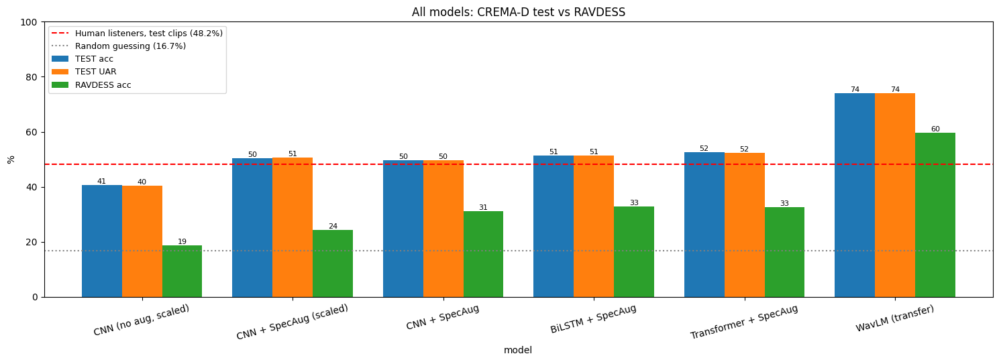
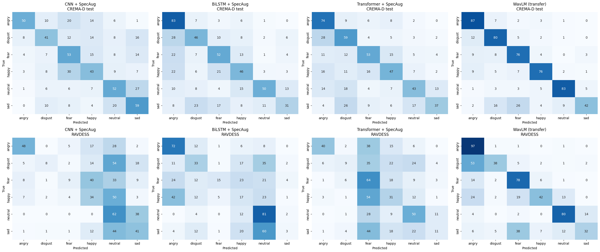
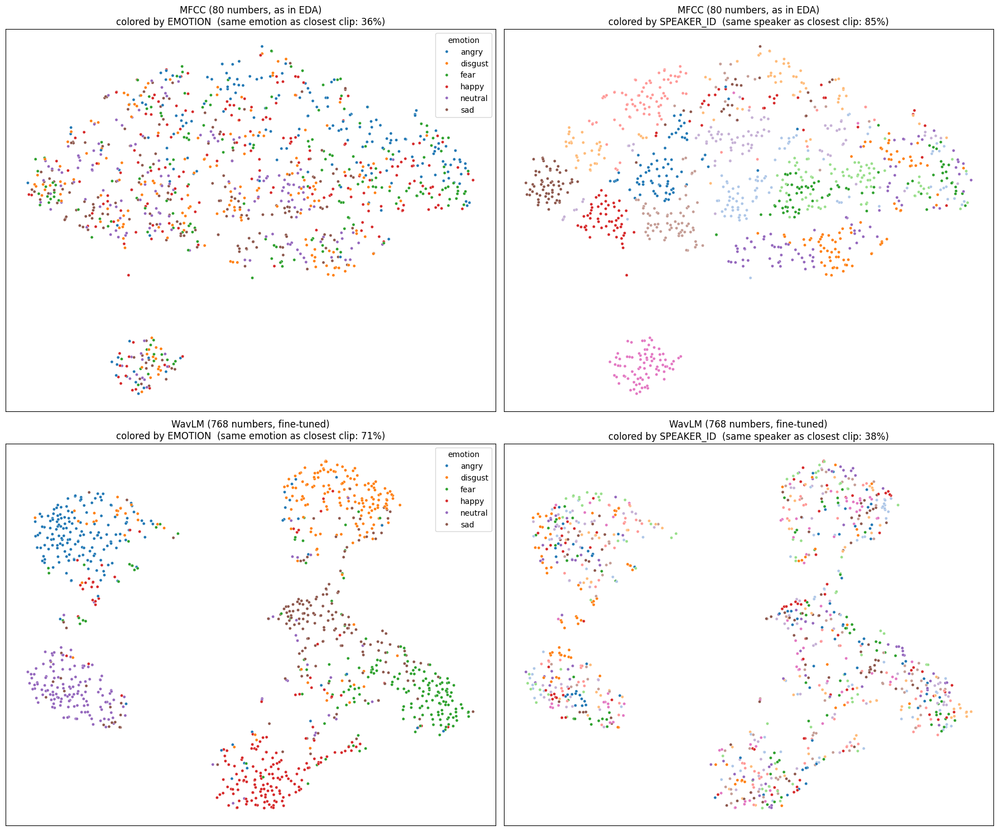
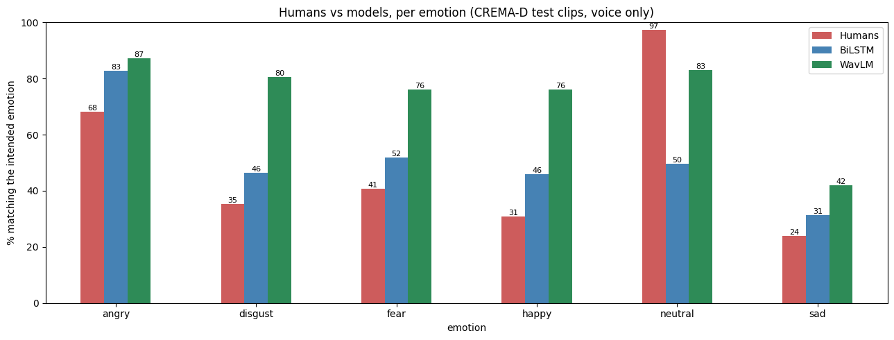
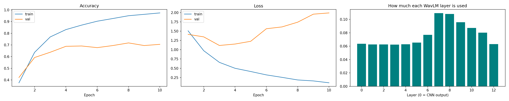

# Speech Emotion Recognition

This project classifies six emotions (angry, disgust, fear, happy, neutral, sad) from short clips of acted speech. Three models are trained from scratch on log-Mel spectrograms: a CNN, a BiLSTM and a Transformer. A pretrained WavLM model is then fine-tuned on raw waveforms. All models are trained on CREMA-D with a speaker-independent split and are also tested on RAVDESS, a second dataset that is never used for training. The work is done in Google Colab notebooks.

## Datasets

| Dataset | Actors | Clips | Use |
|---|---|---|---|
| CREMA-D | 91 | 7,442 (6 emotions) | Train, validation and test |
| RAVDESS | 24 | 1,056 (the same 6 emotions) | Unseen cross-corpus test set only |

## Pipeline

- Audio is resampled to 16 kHz mono.
- Silence at the start and end is trimmed (`top_db=30`).
- Every clip is fixed to 3.5 s by centre crop or zero padding.
- The final models use no per-clip volume scaling.
- The CNN, BiLSTM and Transformer use 128x351 log-Mel spectrograms. WavLM uses the raw waveforms.
- The split is speaker-independent and stratified by gender and race: 65 train / 13 val / 13 test CREMA-D speakers (5,329 / 1,065 / 1,048 clips).
- Each mel band is z-score normalised using statistics from the training set only.

## Key EDA findings

- Listeners matched the intended emotion on only 41.6% of CREMA-D clips (voice only).
- On MFCC features, a clip's nearest neighbour is the same speaker 90% of the time but the same emotion only 35% of the time. This is why the split is by speaker.
- RAVDESS clips are about 50% silence, compared with 6% for CREMA-D.

## Models

| Model | Description | Parameters | Framework |
|---|---|---|---|
| CNN | 4 conv blocks | 391K | Keras |
| BiLSTM | 2 bidirectional layers | 659K | Keras |
| Transformer | Trained from scratch, 4 blocks, 4 heads | 592K | Keras |
| WavLM base+ | Fine-tuned, feature encoder frozen | about 94.6M | PyTorch |

The three Keras models all use SpecAugment. The WavLM classifier takes a learned weighted sum of all 13 hidden layers, applies mean pooling over time and ends in a small MLP head. It is trained for 10 epochs with early stopping on validation accuracy.

## Results

All values are percentages. CREMA-D test = 13 unseen speakers. UAR = unweighted average recall.

| Model | Val acc | Test acc | Test UAR | Test macro-F1 | RAVDESS acc | RAVDESS UAR |
|---|---|---|---|---|---|---|
| CNN (no aug, scaled) | 42.8 | 40.6 | 40.5 | 37.5 | 18.7 | 17.1 |
| CNN + SpecAug (scaled) | 47.4 | 50.5 | 50.6 | 50.0 | 24.2 | 23.8 |
| CNN + SpecAug | 45.9 | 49.6 | 49.7 | 49.8 | 31.2 | 33.9 |
| BiLSTM + SpecAug | 54.6 | 51.3 | 51.3 | 50.6 | 32.9 | 36.9 |
| Transformer + SpecAug | 51.5 | 52.5 | 52.3 | 51.9 | 32.7 | 34.1 |
| WavLM (transfer) | 71.7 | 73.9 | 74.1 | 73.4 | 59.6 | 61.3 |

Human listeners on the same test clips: 48.2%. Random guessing: 16.7%.

"Scaled" means the spectrograms were made from peak-normalised clips. The other rows use spectrograms without per-clip volume scaling.

## Findings

1. SpecAugment improved the CNN on both the test set (about +9 points) and RAVDESS.
2. Removing per-clip volume scaling did not change CREMA-D accuracy much, but it raised CNN accuracy on RAVDESS from 24.2% to 31.2%.
3. The models trained from scratch plateau around 50 to 52% on the test set and 31 to 33% on RAVDESS. WavLM reaches 73.9% on the test set and 59.6% on RAVDESS.
4. t-SNE on the test speakers: with MFCC features the nearest clip is the same speaker 85% of the time and the same emotion 36%. With fine-tuned WavLM features it is the same speaker 38% and the same emotion 71%.
5. WavLM is 84.0% correct on clips where listeners agreed with the label and 64.5% correct where they did not.
6. Per emotion on the test set, humans vs WavLM:

   | Emotion | Humans | WavLM |
   |---|---|---|
   | angry | 68.2 | 87.2 |
   | disgust | 35.2 | 80.4 |
   | fear | 40.8 | 76.0 |
   | happy | 30.7 | 76.0 |
   | neutral | 97.4 | 83.0 |
   | sad | 24.0 | 41.9 |

   Sad is the hardest emotion for every model. Humans over-use "neutral".
7. WavLM is balanced across gender: 73.3% female / 74.3% male on the test set, and 59.3% / 59.8% on RAVDESS.
8. WavLM learned to weight the middle layers most (layers 7 and 8 at about 0.11 each, compared with about 0.06 for the early layers).
9. On RAVDESS, WavLM scores higher on normal-intensity clips (63.5%) than on strong ones (54.8%). This is the opposite of the models trained from scratch.

## Figures

All figures are in [figures/](figures/). The most important ones are shown here.

Model comparison on the CREMA-D test set and RAVDESS:



Confusion matrices (top row: CREMA-D test, bottom row: RAVDESS):



t-SNE of the test clips with MFCC features (top) and fine-tuned WavLM features (bottom):



Humans vs models per emotion:



WavLM training curves and learned layer weights:



## Demo

[notebooks/07_demo.ipynb](notebooks/07_demo.ipynb) starts a Gradio app.

- Record or upload a voice clip and get the probability of each emotion.
- Loudness matching to the training data is optional.
- It works best with clearly acted emotion.
- Accuracy on new microphones and voices is lower than on the test set.

## How to run

1. Open the notebooks in Google Colab with a T4 GPU.
2. Run them in order, 01 to 07.

All intermediate files (spectrograms, waveforms, models, logs) are written to Google Drive under `MyDrive/SER_Project`. They are not stored in this repository. The Python packages used are listed in [requirements.txt](requirements.txt).

## Limitations

- The data is acted speech only.
- Only 6 emotions are covered.
- Each model was trained once (no repeated seeds), so differences of about 2 points may be noise.
- WavLM overfits after about 3 epochs.
- The CNN training histories were not logged.
- The BiLSTM validation accuracy differs slightly between notebook 03 (53.7) and notebook 06 (54.6), because 06 loads the saved checkpoint.

## Repository structure

```
README.md
requirements.txt
.gitignore
notebooks/
  01_eda.ipynb              data checks, EDA, preprocessing, speaker split
  02_cnn.ipynb              CNN: baseline, SpecAugment, no volume scaling
  03_bilstm.ipynb           BiLSTM with SpecAugment
  04_transformer.ipynb      Transformer from scratch with SpecAugment
  05_wavlm_transfer.ipynb   WavLM fine-tuning on raw waveforms
  06_evaluation.ipynb       final scores and comparisons for all models
  07_demo.ipynb             Gradio demo
figures/
  eda_*.png                 figures from 01_eda
  cnn_*.png, bilstm_*.png, transformer_*.png, wavlm_*.png
                            training curves
  eval_*.png                figures from 06_evaluation
```

## References

- Cao, H., Cooper, D. G., Keutmann, M. K., Gur, R. C., Nenkova, A., & Verma, R. (2014). CREMA-D: Crowd-sourced Emotional Multimodal Actors Dataset. IEEE Transactions on Affective Computing.
- Livingstone, S. R., & Russo, F. A. (2018). The Ryerson Audio-Visual Database of Emotional Speech and Song (RAVDESS). PLoS ONE.
- Chen, S., et al. (2022). WavLM: Large-Scale Self-Supervised Pre-Training for Full Stack Speech Processing. IEEE Journal of Selected Topics in Signal Processing.
- Park, D. S., et al. (2019). SpecAugment: A Simple Data Augmentation Method for Automatic Speech Recognition. Interspeech.
